<div align="center">

<a href="README.md"></a>
<a href="README.en.md"></a>

<br>



<br>

[](https://git.io/typing-svg)

<br>

[](https://github.com/tandzp0o)
[](https://ton.id.vn/)
[](https://ltttan-portfolio.vercel.app/)
[](mailto:tannguyen0916@gmail.com)
[](https://www.facebook.com/trongtan.le.18)

</div>


software developer working across **next.js, react, node.js, asp.net core and sql server / mongodb**. i build and ship systems end-to-end — from requirement analysis to production — for universities, schools and small businesses. currently on the team behind **huit's digital transformation systems**, while finishing a master's in information technology focused on **lightweight cnn models and explainable ai**. on the side i make games and small apps for the people around me.


```text
* HEAD -> main   (Jul 2026 – present)  HUIT · Institute of Digital Transformation — Developer
│   + Build university-wide student systems: training-point (điểm rèn luyện) and
│     social-work-point (điểm CTXH) management, faculty operations
│   + ASP.NET Core + TypeScript + SQL Server, containerised with Docker
│
* (Jan 2026 – Jul 2026)  Wows — R&D
│   + Developed and deployed ERP/CRM modules using Next.js (App Router), Node.js, MongoDB
│   + Handled user workflows, forms and real-time data operations
│   + Collaborated with clients on requirement gathering, training and troubleshooting
│   + Integrated APIs and optimized database queries for performance
│
* (Apr 2025 – Oct 2025)  Mạng Xuyên Việt — Developer
    + Built and maintained ASP.NET WebForms applications
    + Integrated frontend with backend and SQL Server
    + Implemented features based on client requirements, with a focus on performance
```


#### 🎓 university & student systems

| project | what it does | stack |
|:---|:---|:---|
| **training-point management** · huit | students register and self-assess each term; staff review, approve and report |    |
| **social-work points admin** · huit | tracks community-service activities and points per student |    |
| **faculty operations** · huit | day-to-day management and coordination for a faculty |   |
| **student results system** | students, courses, enrolment, grading and statistics · clean architecture, jwt roles |    |
| **primary-school class log** | replaces the teachers' weekly excel lesson-plan workbook |    |
| **experimental center management** | responsive management interfaces for a lab centre |    |

#### 🏢 erp / crm & business

| project | what it does | stack |
|:---|:---|:---|
| **erp / crm suites** | sales, customers, workflows and reporting for several companies |    |
| **garage crm** | customers, vehicles and repair jobs for an auto garage |   |
| **project manager** · **uniform shop** | internal task tracking · online ordering for school uniforms |   |
| **business websites** | asp.net webforms sites, landing pages, e-commerce |   |

#### 🎮 games

| project | what it does | stack |
|:---|:---|:---|
| **tu tiên chí** | top-down cultivation (xianxia) rpg — maps, skills, hand-drawn-style sprites and vfx |    |
| **tu tiên mmo prototype** | browser experiment syncing 50–200 players across portal-linked maps |   |
| **asset console** | one admin site to review characters, animations, audio and chapters for the game |    |

#### 💜 community & web apps

| project | what it does | stack |
|:---|:---|:---|
| **gymdate** | gym tracker with an ai coach on free providers — a modified build of the open-source [openGym](https://github.com/DuarteSantos8/openGym) (agpl-3.0) |   |
| **[việc nhà](https://todolist-housework.vercel.app)** | family chore pwa — push reminders that keep nagging until the job is ticked off |    |
| **driving school webapp** | theory practice, mock tests, 1-on-1 booking and practice-hour tracking for a driving instructor |    |
| **[expense tracker](https://github.com/tandzp0o/expense-tracker)** | personal spending tracker with firebase auth |    |

#### 🧠 ai & research

| project | what it does | stack |
|:---|:---|:---|
| **lw-msxai** · master's thesis | lightweight cnn with built-in explainability for detecting paint-coating surface defects |  |
| **[ecg analyzer](https://ecg-analyzer.vercel.app)** | walks through an ecg image using a 5-step clinical reading method |  |
| **adsshield ai** | saas concept that watches ad accounts for risk — demand-validation stage |  |

> most of this work lives in private or organisation repositories, so it won't show up in my public repo list.


**frontend**


**backend**


**database**


**game & ai**


**tools**


🎓 **ho chi minh city university of industry and trade (huit)** — master's degree in information technology *(thesis & final defense in progress)*

<br>


<div align="center">

</div>
