<div align="center">

<a href="README.md"></a>
<a href="README.en.md"></a>

<br>



<br>

[](https://git.io/typing-svg)

<br>

[](https://github.com/tandzp0o)
[](https://ton.id.vn/)
[](https://ltttan-portfolio.vercel.app/)
[](mailto:tannguyen0916@gmail.com)
[](https://www.facebook.com/trongtan.le.18)

</div>


lập trình viên phần mềm làm việc với **next.js, react, node.js, asp.net core và sql server / mongodb**. mình xây và đưa hệ thống vào vận hành từ đầu đến cuối — từ phân tích yêu cầu tới production — cho trường đại học, trường học và doanh nghiệp nhỏ. hiện mình tham gia nhóm phát triển **các hệ thống chuyển đổi số của huit**, đồng thời hoàn thành chương trình thạc sĩ công nghệ thông tin theo hướng **mô hình cnn nhẹ và ai giải thích được (xai)**. ngoài giờ mình làm game và các ứng dụng nhỏ cho những người xung quanh.


```text
* HEAD -> main   (07/2026 – nay)  HUIT · Viện Chuyển đổi số — Lập trình viên
│   + Xây các hệ thống nghiệp vụ sinh viên toàn trường: quản lý điểm rèn luyện,
│     điểm công tác xã hội (CTXH), điều hành khoa
│   + ASP.NET Core + TypeScript + SQL Server, đóng gói bằng Docker
│
* (01/2026 – 07/2026)  Wows — R&D
│   + Phát triển và triển khai các module ERP/CRM bằng Next.js (App Router), Node.js, MongoDB
│   + Xử lý luồng nghiệp vụ, biểu mẫu và dữ liệu thời gian thực
│   + Làm việc với khách hàng: lấy yêu cầu, đào tạo sử dụng và xử lý sự cố
│   + Tích hợp API và tối ưu truy vấn cơ sở dữ liệu
│
* (04/2025 – 10/2025)  Mạng Xuyên Việt — Lập trình viên
    + Xây dựng và bảo trì ứng dụng ASP.NET WebForms
    + Tích hợp frontend với backend và SQL Server
    + Hiện thực tính năng theo yêu cầu khách hàng, chú trọng hiệu năng
```


#### 🎓 hệ thống đại học & nghiệp vụ sinh viên

| dự án | làm gì | công nghệ |
|:---|:---|:---|
| **quản lý điểm rèn luyện** · huit | sinh viên đăng ký, tự đánh giá theo đợt; cán bộ duyệt, tổng hợp và báo cáo |    |
| **quản trị điểm ctxh** · huit | theo dõi hoạt động công tác xã hội và điểm của từng sinh viên |    |
| **điều hành khoa** · huit | quản lý, điều phối công việc hằng ngày của khoa |   |
| **hệ thống kết quả học tập** | sinh viên, môn học, đăng ký môn, chấm điểm, thống kê · clean architecture, phân quyền jwt |    |
| **sổ đầu bài tiểu học** | thay file excel "lịch báo giảng" của giáo viên |    |
| **quản lý trung tâm thí nghiệm** | giao diện quản lý responsive cho trung tâm thí nghiệm |    |

#### 🏢 erp / crm & doanh nghiệp

| dự án | làm gì | công nghệ |
|:---|:---|:---|
| **các hệ thống erp / crm** | bán hàng, khách hàng, quy trình và báo cáo cho nhiều doanh nghiệp |    |
| **garage crm** | khách hàng, xe và phiếu sửa chữa cho gara ô tô |   |
| **quản lý dự án** · **bán đồng phục** | theo dõi công việc nội bộ · đặt đồng phục trực tuyến |   |
| **website doanh nghiệp** | web asp.net webforms, landing page, thương mại điện tử |   |

#### 🎮 game

| dự án | làm gì | công nghệ |
|:---|:---|:---|
| **tu tiên chí** | game nhập vai tu tiên góc nhìn từ trên xuống — bản đồ, chiêu thức, sprite và vfx phong cách vẽ tay |    |
| **tu tiên mmo (thử nghiệm)** | thử đồng bộ 50–200 người chơi trên web, nhiều map nối bằng cổng |   |
| **trang quản trị asset** | một trang duy nhất để duyệt nhân vật, hoạt ảnh, âm thanh và chương truyện của game |    |

#### 💜 cộng đồng & web app

| dự án | làm gì | công nghệ |
|:---|:---|:---|
| **gymdate** | ứng dụng theo dõi tập gym, có ai coach dùng nhà cung cấp miễn phí — bản chỉnh sửa từ mã nguồn mở [openGym](https://github.com/DuarteSantos8/openGym) (agpl-3.0) |   |
| **[việc nhà](https://todolist-housework.vercel.app)** | pwa nhắc việc nhà cho gia đình — thông báo đẩy tự nhắc lại đến khi việc được đánh dấu xong |    |
| **webapp dạy lái xe** | ôn lý thuyết, thi thử, đặt lịch 1 kèm 1 và theo dõi giờ tập lái cho thầy dạy lái |    |
| **[expense tracker](https://github.com/tandzp0o/expense-tracker)** | quản lý chi tiêu cá nhân, đăng nhập bằng firebase |    |

#### 🧠 ai & nghiên cứu

| dự án | làm gì | công nghệ |
|:---|:---|:---|
| **lw-msxai** · đề án thạc sĩ | mạng cnn nhẹ tích hợp xai để nhận diện lỗi bề mặt sơn phủ |  |
| **[ecg analyzer](https://ecg-analyzer.vercel.app)** | phân tích ảnh điện tâm đồ theo quy trình đọc 5 bước |  |
| **adsshield ai** | ý tưởng saas giám sát rủi ro tài khoản quảng cáo — đang kiểm chứng nhu cầu |  |

> phần lớn các dự án nằm trong repo riêng tư hoặc repo của tổ chức nên không hiện trong danh sách repo công khai.



**frontend**


**backend**


**cơ sở dữ liệu**


**game & ai**


**công cụ**


🎓 **trường đại học công thương tp. hồ chí minh (huit)** — thạc sĩ công nghệ thông tin *(đang thực hiện đề án & chuẩn bị bảo vệ)*

<br>


<div align="center">

</div>
